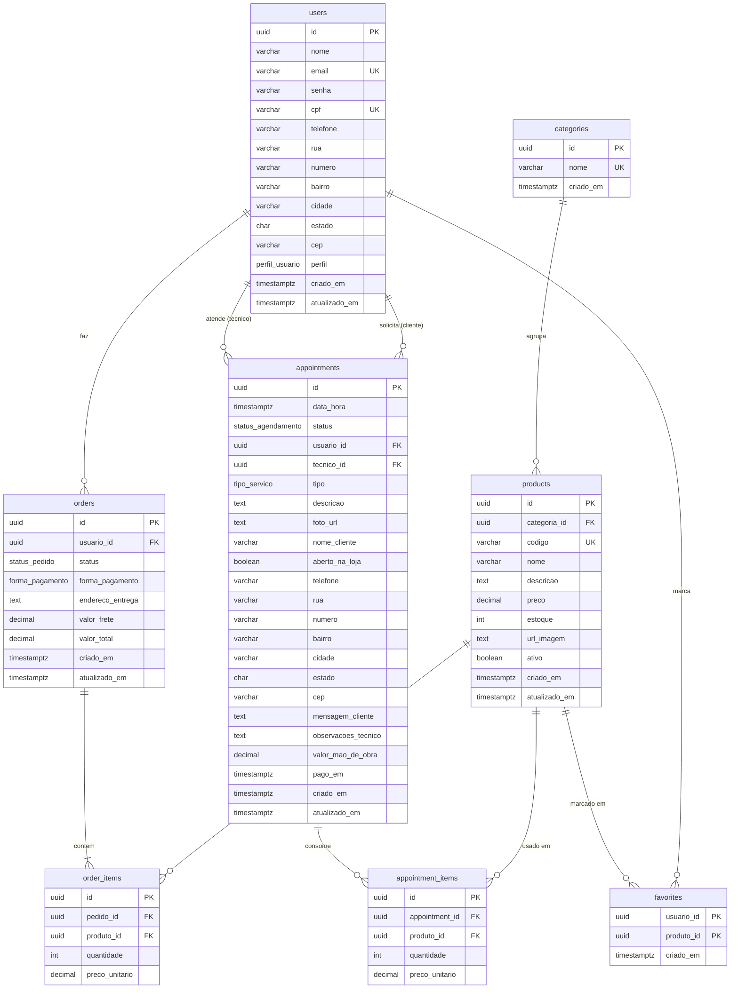

# Modelagem de dados

O banco é PostgreSQL 16. O esquema é definido em `backend/prisma/schema.prisma` e acessado pelo Prisma. Os nomes de tabelas e colunas estão em português, e os modelos do Prisma usam o nome em inglês.

## 1. Diagrama entidade-relacionamento

## 2. Dicionário de dados

### 2.1 users

Pessoas que acessam o sistema, clientes e administradores.

| Coluna | Tipo | Regra |
| --- | --- | --- |
| id | uuid | chave primária, gerada pelo banco |
| nome | varchar(150) | obrigatório |
| email | varchar(255) | obrigatório, único |
| senha | varchar(255) | hash bcrypt |
| cpf | varchar(11) | obrigatório, único, só dígitos |
| telefone | varchar(20) | opcional |
| rua, numero, bairro, cidade, estado, cep | varchar | endereço opcional; `estado` tem 2 caracteres e `cep` até 8 |
| perfil | perfil_usuario | `CLIENTE` por padrão |
| criado_em, atualizado_em | timestamptz | preenchidos pelo banco |

### 2.2 categories

| Coluna | Tipo | Regra |
| --- | --- | --- |
| id | uuid | chave primária |
| nome | varchar(80) | obrigatório, único |
| criado_em | timestamptz | data de criação |

### 2.3 products

| Coluna | Tipo | Regra |
| --- | --- | --- |
| id | uuid | chave primária |
| categoria_id | uuid | chave estrangeira para categories |
| codigo | varchar(160) | obrigatório, único. É a chave natural usada pelo seed |
| nome | varchar(150) | obrigatório |
| descricao | text | opcional |
| preco | decimal(10,2) | obrigatório |
| estoque | int | padrão 0 |
| url_imagem | text | caminho da imagem, por exemplo `/api/uploads/produtos/arquivo.jpg` |
| ativo | boolean | padrão verdadeiro. Produto inativo não pode ser comprado |
| criado_em, atualizado_em | timestamptz | controle |

### 2.4 orders e order_items

`orders` guarda o cabeçalho do pedido da loja. `order_items` guarda cada linha.

| Coluna | Tipo | Regra |
| --- | --- | --- |
| orders.usuario_id | uuid | chave estrangeira para users, sem remoção em cascata |
| orders.status | status_pedido | padrão `PENDENTE` no banco; o serviço grava `PAGO` |
| orders.forma_pagamento | forma_pagamento | `PIX`, `CARTAO_CREDITO` ou `BOLETO` |
| orders.endereco_entrega | text | endereço copiado no momento da compra |
| orders.valor_frete | decimal(10,2) | padrão 0 |
| orders.valor_total | decimal(10,2) | soma dos itens mais frete |
| order_items.pedido_id | uuid | chave estrangeira para orders, com remoção em cascata |
| order_items.produto_id | uuid | chave estrangeira para products |
| order_items.quantidade | int | quantidade comprada |
| order_items.preco_unitario | decimal(10,2) | preço do produto na hora da compra |

Cada produto aparece uma vez por pedido (restrição única em `pedido_id` e `produto_id`).

### 2.5 appointments e appointment_items

`appointments` guarda o pedido de visita e a ordem de serviço, na mesma tabela. `appointment_items` guarda os produtos usados.

| Coluna | Tipo | Regra |
| --- | --- | --- |
| data_hora | timestamptz | data e hora da visita |
| status | status_agendamento | padrão `AGUARDANDO` |
| usuario_id | uuid, opcional | cliente cadastrado; nulo no atendimento de balcão sem cadastro |
| tecnico_id | uuid, opcional | técnico responsável, referência a users |
| tipo | tipo_servico | tipo do serviço |
| descricao | text | problema descrito pelo cliente |
| foto_url | text | foto opcional |
| nome_cliente | varchar(150) | nome do cliente sem cadastro |
| aberto_na_loja | boolean | verdadeiro quando o administrador abriu o atendimento |
| telefone, rua, numero, bairro, cidade, estado, cep | varchar | contato e endereço copiados do cliente |
| mensagem_cliente | text | motivo da recusa ou do cancelamento, visível ao cliente |
| observacoes_tecnico | text | diagnóstico e reparos, visível só à gestão |
| valor_mao_de_obra | decimal(10,2) | nulo até ser informado |
| pago_em | timestamptz | nulo enquanto a pagar |
| appointment_items.appointment_id | uuid | chave estrangeira com remoção em cascata |
| appointment_items.produto_id | uuid | chave estrangeira para products |
| appointment_items.quantidade, preco_unitario | int, decimal(10,2) | quantidade usada e preço na hora |

Os usuários referenciados em `usuario_id` e `tecnico_id` não podem ser apagados enquanto houver atendimento ligado a eles (`onDelete: Restrict`).

### 2.6 favorites

Chave primária composta por `usuario_id` e `produto_id`, com remoção em cascata nos dois lados. A tabela existe, mas a API ainda não tem rotas para ela.

## 3. Enumerações

| Enum | Valores |
| --- | --- |
| perfil_usuario | CLIENTE, ADMINISTRADOR |
| forma_pagamento | PIX, CARTAO_CREDITO, BOLETO |
| status_pedido | PENDENTE, PAGO, ENVIADO, ENTREGUE, CANCELADO |
| status_agendamento | DISPONIVEL, AGUARDANDO, AGENDADO, EM_ANDAMENTO, CONCLUIDO, CANCELADO, RECUSADO |
| tipo_servico | LIMPEZA, BOMBA_FILTRO, VAZAMENTO, INSTALACAO, OUTRO |

O valor `DISPONIVEL` de `status_agendamento` vem de uma versão antiga da agenda. O frontend o trata como "aguardando", e o fluxo atual não o produz.

## 4. Índices e restrições

| Tabela | Restrição ou índice | Finalidade |
| --- | --- | --- |
| users | único em email e em cpf | impedir contas duplicadas |
| categories | único em nome | impedir categorias repetidas |
| products | único em codigo; índice em categoria_id | identificar o produto e filtrar por categoria |
| orders | índice em usuario_id | listar pedidos de um cliente |
| order_items | único em (pedido_id, produto_id); índice em produto_id | uma linha por produto e consulta por produto |
| appointments | índices em (status, data_hora), em usuario_id e em (tecnico_id, data_hora) | agenda, histórico do cliente e conflito de técnico |
| appointment_items | único em (appointment_id, produto_id); índice em produto_id | uma linha por produto |

O banco também aplica restrições `CHECK`, criadas nas migrações SQL em `backend/prisma/migrations`:

| Tabela | Regra |
| --- | --- |
| users | CPF com exatamente 11 dígitos; CEP com exatamente 8 dígitos |
| products | preço maior que zero; estoque maior ou igual a zero |
| orders | frete e total maiores ou iguais a zero |
| order_items | quantidade e preço unitário maiores que zero |
| appointment_items | quantidade e preço unitário maiores que zero |
| appointments | o atendimento precisa ter cliente cadastrado ou nome de cliente (`ck_agendamentos_cliente`) |

## 5. Decisões de modelagem

Preços e endereços são copiados para o pedido ou atendimento no momento da criação. Assim, reajustar um produto ou editar o perfil do cliente não altera o histórico.

O pedido de visita e a ordem de serviço ficam na mesma tabela, porque são a mesma entidade em momentos diferentes: o cliente preenche o pedido e o administrador completa a ordem.

O atendimento aceita cliente nulo e `nome_cliente`, para atender quem não tem cadastro no balcão.

Valores monetários usam `decimal(10,2)` e as datas usam `timestamptz`, guardadas em UTC.
