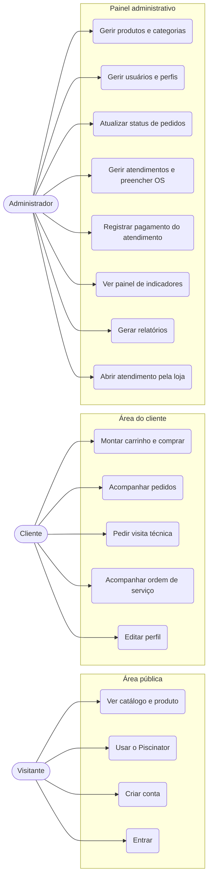
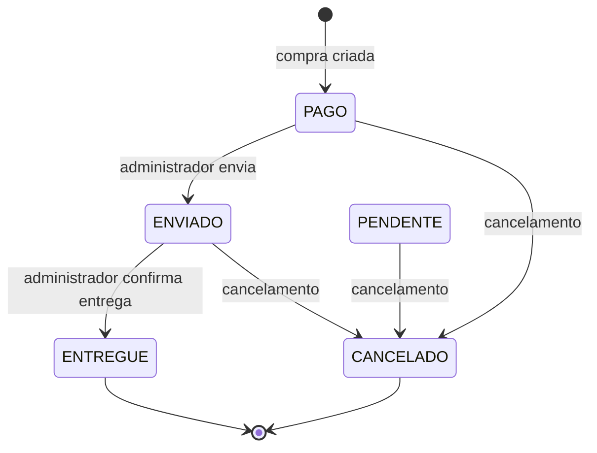
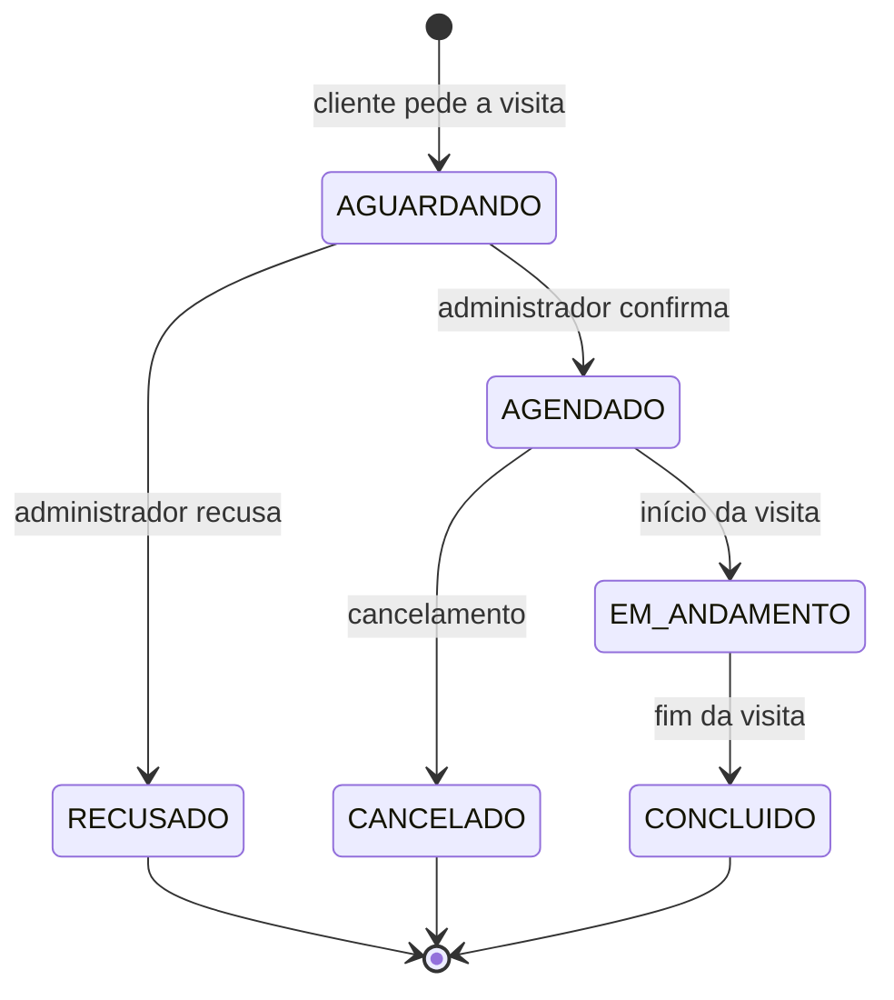
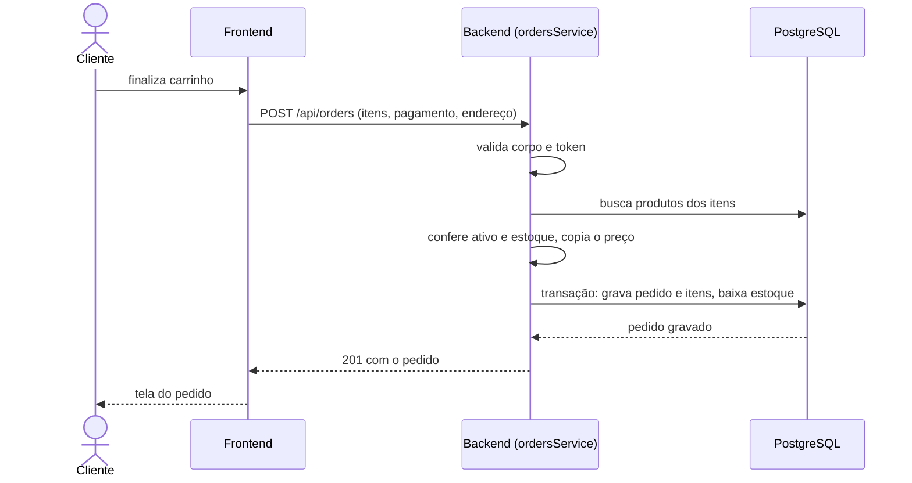
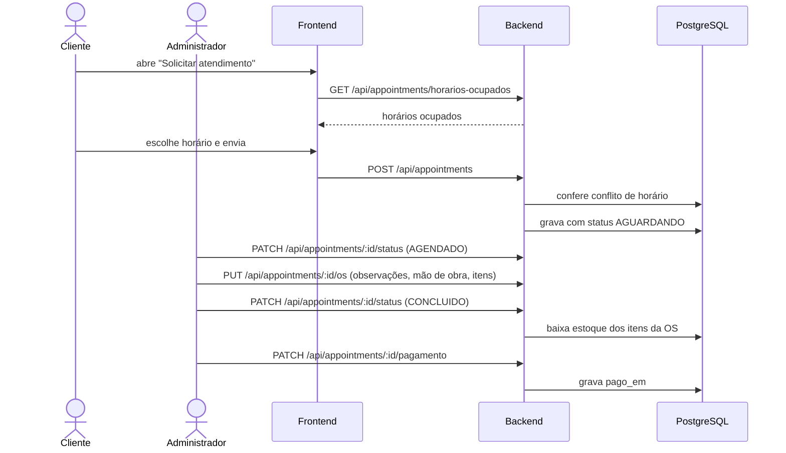

# Casos de uso e fluxos

## 1. Atores

| Ator | Descrição |
| --- | --- |
| Visitante | Pessoa sem login |
| Cliente | Usuário com perfil `CLIENTE` |
| Administrador | Usuário com perfil `ADMINISTRADOR`. Também atua como técnico na ordem de serviço |

O cliente e o administrador herdam o que o visitante faz.

## 2. Diagrama de casos de uso

## 3. Descrição dos casos de uso principais

### UC05 Comprar produtos

Ator: cliente. Requisitos: RF12, RF13.

Pré-condição: cliente logado e carrinho com pelo menos um item.

Fluxo principal:

1. O cliente abre o carrinho e confere os itens.
2. Informa o endereço de entrega e escolhe a forma de pagamento.
3. O sistema valida cada item (produto existente, ativo e com estoque suficiente).
4. O sistema grava o pedido com o preço atual de cada produto, baixa o estoque e devolve o pedido com status `PAGO`.
5. O cliente vê o pedido na tela de acompanhamento.

Fluxo alternativo: se um produto estiver inativo ou sem estoque, nenhuma parte do pedido é gravada e o sistema informa o produto com problema.

### UC07 Pedir visita técnica

Ator: cliente. Requisitos: RF17, RF18, RF19.

1. O cliente escolhe o tipo de serviço e descreve o problema.
2. O sistema mostra os horários ocupados do período.
3. O cliente escolhe data e horário livres, confere o endereço e, se quiser, anexa uma foto.
4. O sistema grava o atendimento com status `AGUARDANDO`.

Fluxo alternativo: se outro cliente reservou o horário no intervalo, o sistema responde 409 com a mensagem "Esse horário já foi reservado" e o cliente escolhe outro.

### UC13 Gerir atendimento e preencher a ordem de serviço

Ator: administrador. Requisitos: RF21 a RF24.

1. O administrador abre o atendimento em `AGUARDANDO` e o confirma (`AGENDADO`) ou o recusa (`RECUSADO`) com uma mensagem ao cliente.
2. No dia da visita, atribui o técnico e marca `EM_ANDAMENTO`.
3. Durante o atendimento, registra observações, mão de obra e produtos usados.
4. Ao marcar `CONCLUIDO`, o sistema baixa o estoque dos produtos usados.

Fluxo alternativo: o administrador cancela um atendimento `AGENDADO` informando o motivo.

### UC14 Registrar pagamento do atendimento

Ator: administrador. Requisito: RF25.

O sistema aceita o pagamento apenas para atendimento `CONCLUIDO` e sem pagamento registrado. O atendimento passa a ter `pago_em` preenchido e sai de "a receber".

### UC17 Abrir atendimento pela loja

Ator: administrador. Requisito: RF20.

O administrador abre o atendimento em nome de um cliente cadastrado ou informando apenas o nome de um cliente sem cadastro. Nesse caso o atendimento fica com `aberto_na_loja` verdadeiro, e o administrador pode escolher qualquer horário, inclusive um já ocupado.

## 4. Ciclo de vida do pedido

O estado `PENDENTE` existe no banco como valor padrão, mas o serviço grava `PAGO` na criação, porque o pagamento é simulado. O administrador só consegue pedir os status `ENVIADO`, `ENTREGUE` e `CANCELADO`. Enviar exige que o pedido esteja `PAGO`, e entregar exige `ENVIADO`. O cancelamento devolve o estoque dos itens.

## 5. Ciclo de vida do atendimento

Depois de `CONCLUIDO`, o administrador ainda registra o pagamento, que não muda o status e preenche `pago_em`. Qualquer mudança fora das setas acima retorna erro 409.

## 6. Fluxo de compra

## 7. Fluxo de pedido de visita

## 8. Piscinator

O questionário tem oito perguntas de sim ou não. Cada resposta "sim" soma pontos aos produtos cujo nome, descrição ou categoria contenham as palavras ligadas à pergunta. O resultado ordena por pontuação e mostra até quatro produtos, cada um com o motivo da indicação. Se todas as respostas forem "não", o resultado traz produtos de manutenção de rotina. A lógica está em `frontend/src/crud/produtos/recomendacaoPiscinator.ts` e roda no navegador, sobre os produtos que a API entrega.
