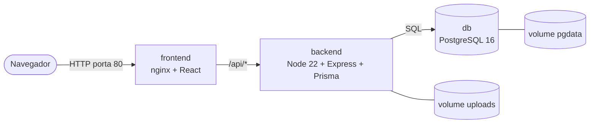
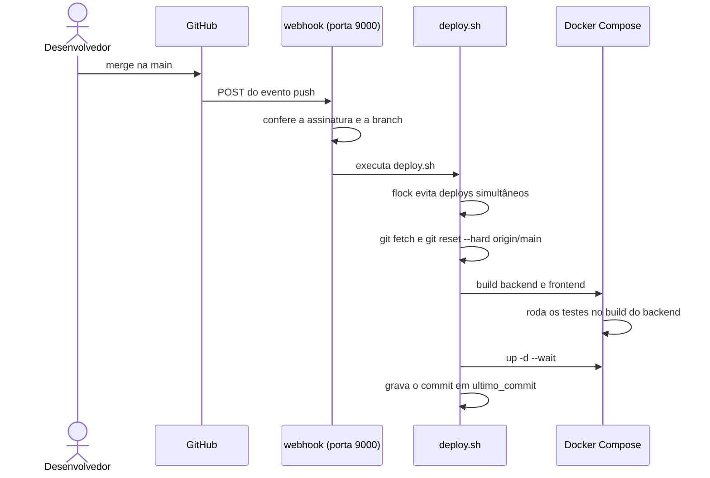

# Arquitetura e implantação

## 1. Visão geral

O sistema tem três partes: um frontend em React, um backend em Node com TypeScript e um banco PostgreSQL. As três rodam como containers Docker na mesma máquina, orquestrados por `docker-compose.yml`.



O nginx serve os arquivos estáticos do frontend, devolve `index.html` para qualquer rota do React Router e repassa as requisições de `/api/` para o backend. Apenas a porta 80 do frontend é publicada. O backend e o banco só são alcançáveis pela rede interna do Compose.

## 2. Tecnologias

| Camada | Tecnologia |
| --- | --- |
| Frontend | React 19, React Router 7, Vite 8, TypeScript 6, Vitest |
| Backend | Node 22, Express, TypeScript, Prisma com o adaptador `pg`, JWT, bcrypt, PDFKit, Vitest |
| Banco | PostgreSQL 16 |
| Infraestrutura | Docker e Docker Compose, nginx, webhook de deploy, cron |

## 3. Backend em camadas

O backend segue a sequência rota, controller, service e repository.

| Camada | Responsabilidade | Pasta |
| --- | --- | --- |
| Rotas | Associa método e caminho a um controller e aplica os middlewares de login e de perfil | `backend/src/routes` |
| Middlewares | `verificaToken` valida o JWT, `verificaAdmin` exige o perfil administrador, e os de upload recebem arquivos | `backend/src/middleware` |
| Controllers | Leem a requisição, chamam o service e montam a resposta HTTP | `backend/src/controller` |
| Services | Regras de negócio e validação de entrada | `backend/src/service` |
| Repositories | Único ponto de acesso ao banco, via Prisma | `backend/src/repository` |
| Modelos e erros | Tipos de entrada e saída e a classe `AppError` com o código HTTP | `backend/src/models` |

Essa separação mantém as regras testáveis sem banco: os testes em `backend/tests` trocam o repository por simulações.

## 4. Frontend

O frontend é uma aplicação de página única. `App.tsx` define as rotas em três grupos.

| Grupo | Rotas |
| --- | --- |
| Portal público | `/`, `/sobre`, `/loja`, `/produto/:id`, `/piscinator`, `/carrinho`, `/entrar`, `/criar-conta` |
| Área do cliente (exige login) | `/perfil`, `/solicitar-atendimento`, `/pedido/:id`, `/minha-conta/atendimentos/:id` |
| Painel administrativo (exige administrador) | `/admin`, `/admin/usuarios`, `/admin/produtos`, `/admin/atendimentos`, `/admin/atendimentos/:id`, `/admin/pedidos` e `/admin/pagamentos`. Os relatórios ficam no painel inicial, e `/admin/relatorios` redireciona para ele |

Os componentes `RotaLogado` e `RotaAdmin` bloqueiam o acesso de quem não tem permissão. A comunicação com a API fica em `frontend/src/api`, um módulo por assunto. A sessão do usuário vem do login e as preferências de visualização ficam no `localStorage`.

## 5. Containers e volumes

| Serviço | Imagem | Detalhes |
| --- | --- | --- |
| db | `postgres:16-alpine` | Volume `pgdata`, healthcheck com `pg_isready` |
| backend | build de `backend/Dockerfile` | Build em dois estágios. O estágio de build roda `prisma generate`, os testes e a compilação. A imagem final roda `prisma migrate deploy` e inicia o servidor. Volume `uploads` em `/app/uploads` |
| frontend | build de `frontend/Dockerfile` | nginx na porta 80, depende do backend saudável |

Os três serviços usam `restart: unless-stopped`. O backend só sobe depois que o banco está saudável, e o frontend só sobe depois que o backend responde em `/api/products`.

Como os testes rodam durante o build da imagem do backend, um commit que quebre um teste não gera imagem nova e o deploy falha sem derrubar a versão em execução.

Os volumes `pgdata` e `uploads` guardam os dados. Eles sobrevivem a `docker compose up --force-recreate`, mas o comando `docker compose down -v` os apaga e nunca deve ser usado em produção.

### Variáveis de ambiente

| Variável | Uso |
| --- | --- |
| `POSTGRES_PASSWORD` | Senha do banco, usada pelo db e pelo backend |
| `JWT_SECRET` | Segredo de assinatura dos tokens. O backend não inicia sem ele |
| `PUBLIC_BASE_URL` | Endereço público usado para montar a URL das imagens. Vazio, o backend usa o endereço da requisição |
| `UPLOAD_DIR` | Pasta das imagens dentro do container (`/app/uploads`) |
| `DATABASE_URL` | Conexão do backend com o banco, montada pelo Compose |

## 6. Implantação contínua

O deploy acontece na VM (`177.44.248.94`) por webhook, sem GitHub Actions.



O serviço `deploy-hook.service` (systemd) mantém o webhook rodando na porta 9000, e a configuração fica em `hooks.json` na VM, fora do repositório. O modelo está em `deploy/hooks.example.json`. O log de cada deploy fica em `/home/univates/deploy/deploy.log`.

## 7. Backup e restauração

O script `deploy/backup.sh` roda todo dia às 03:10 pelo crontab do root. Ele gera dois arquivos em `/home/univates/backups`, ambos com permissão 600:

| Arquivo | Conteúdo |
| --- | --- |
| `db_AAAAMMDD_HHMMSS.dump` | Dump do banco no formato custom do `pg_dump` |
| `uploads_AAAAMMDD_HHMMSS.tar.gz` | Cópia compactada da pasta de imagens |

O script confere o espaço livre antes de começar, grava em arquivo temporário, valida o dump com `pg_restore -l` e só então renomeia. Um `flock` impede duas execuções ao mesmo tempo, e arquivos com mais de 7 dias são removidos. O resultado fica registrado em log.

Para testar uma restauração sem tocar no banco em uso:

```bash
cd ~/bruxel
ULTIMO=$(sudo ls -t /home/univates/backups/db_*.dump | head -1)
sudo docker compose exec -T db createdb -U bruxel bruxel_teste_restore
sudo cat "$ULTIMO" | sudo docker compose exec -T db pg_restore -U bruxel -d bruxel_teste_restore --no-owner
sudo docker compose exec -T db psql -U bruxel -d bruxel_teste_restore -c "SELECT count(*) FROM products;"
sudo docker compose exec -T db dropdb -U bruxel bruxel_teste_restore
```

O `deploy/verificar-uploads.sh` confere se o volume de imagens está montado, tem escrita e tem espaço livre. O teste `deploy/test/backup.test.sh` valida o script de backup contra um Postgres local.

Os backups ficam na mesma máquina do banco. Copiar os arquivos para outro local é um passo manual.

## 8. Dados de demonstração

O script `backend/scripts/seed-loja.mjs` carrega o catálogo de `backend/seed/catalogo.json` (29 produtos de piscina em categorias) e os usuários de um arquivo JSON local. O catálogo é gravado por `codigo`, então rodar o script de novo atualiza os produtos sem duplicá-los. Usuários são criados pelo e-mail, e quem já existe não é alterado. As imagens ficam em `backend/seed/imagens`, fora do Git, e o script as copia para o volume de uploads. O `backend/scripts/baixar-imagens.mjs` baixa imagens de uso livre pelo Openverse e registra os créditos em `CREDITOS.md`.

O passo a passo de uso está no [README da raiz](../README.md), nas seções "Backup e restauração" e "Dados de demonstração da loja".

## 9. Segurança

Senhas ficam com hash bcrypt, e o token JWT é assinado com um segredo vindo do ambiente. As rotas administrativas passam pelos middlewares de token e de perfil. Os preços nunca vêm do cliente: o backend os lê do banco. Os uploads aceitam apenas imagens de até 5 MB.

Limitações atuais: a aplicação responde por HTTP puro até que exista domínio com certificado, o CORS está aberto para qualquer origem, e o CPF é validado apenas pelo formato. O arquivo `deploy/hooks.json` foi versionado por engano numa versão anterior do repositório e o segredo do webhook precisa ser trocado e o arquivo removido do controle de versão com `git rm --cached`.
